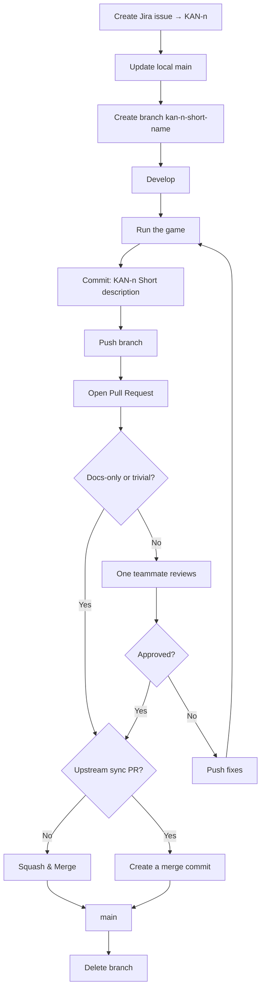

# KimchiBaguette: Git Workflow

> **Revised 2026-11-23.** This revision relaxes the rules we were enforcing
> earlier and adds the `KAN-<n>` ticket key requirement. It applies to our team's
> own repository only. Contributions to the shared course repository follow the
> course maintainers' rules, not ours.

## 1. The short version

We use **GitHub Flow**: one long-lived `main`, a short-lived branch per task, and
a Pull Request to get back into `main`.

Why this and not something heavier: we have no CI that runs the game, so `main`
staying runnable is what protects us, and a Pull Request is the cheapest way to
get a second pair of eyes before that happens. Gitflow's release and hotfix
branches, GitLab Flow's environment branches and trunk-based development's daily
merge cadence all assume things we do not have — releases, deployments, or
automated tests. There is nothing for them to do here.

Five rules carry the whole process. Everything after this section is detail.

1. Every commit and PR title starts with its Jira key, `KAN-<n>` (§2).
2. Branch from `main`, never commit to `main` directly.
3. Open a PR to merge. **Squash and Merge**, except upstream sync PRs (§5).
4. Run the game before you ask for a merge. We have no CI; this is the only gate.
5. Resolve your own conflicts on your own branch, and run the game again after.

### Repositories

- `origin` — [`Littlecocoa/KimchiBaguette2`](https://github.com/Littlecocoa/KimchiBaguette2),
  the repository we work in and the only remote configured. **Every rule here
  applies to it.** All our PRs target its `main`.
- The shared course repository,
  [`oh-gnues/Invaders-SDP-24592`](https://github.com/oh-gnues/Invaders-SDP-24592),
  is **not** configured as a remote here, and `origin` is not a fork of it, so
  there is nothing to pull from or sync against today. **Never open a PR against
  the course repository** — only the collaborator does that.

## 2. Ticket keys — `KAN-<n>` (required)

Every commit message and every PR title **must** begin with the task's Jira issue
key, so that the work links back to the board.

```
KAN-3 Add pause menu
```

### Where the number comes from

**Jira assigns it. You never pick it yourself.**

Create the issue on our Jira board first, and Jira gives it the next key —
`KAN-1`, `KAN-2`, `KAN-3` and so on. That key is what goes in your commits
and your PR title. Because Jira hands the numbers out, they increase on their own
and two people can never end up on the same one.

- **One task, one number.** Every commit on that task's branch carries the same key.
- **No Jira issue yet? Create it first**, then start the branch. A commit carrying a
  key that does not exist on the board links to nothing.
- **Never invent a number**, and never reuse one or go back to a lower one. A guessed
  number will collide with whatever Jira gives out next.
- Gaps are normal. A deleted or abandoned issue leaves its number unused — the next
  task still takes the next key Jira gives, not the gap.

### Format

```
KAN-<n> <short description>
KAN-<n> [Type] <short description>     ← [Type] is optional
```

The `[Type]` tag (`[Feat]` `[Fix]` `[Refactor]` `[Docs]` `[Test]` `[Style]`) is no
longer required. Use it when it adds clarity, skip it when the description already
says what kind of change it is.

### Examples

```
KAN-3 Add pause menu
KAN-4 [Fix] Resolve boss collision bug
KAN-5 Add screen shake engine
KAN-6 [Docs] Update boss system PRD
KAN-12 Add boss dialogue lines
```

Not acceptable:

```
Add pause menu              ← no key
kan-3 Add pause menu        ← lowercase
KAN3 Add pause menu         ← missing hyphen
KAN-3 fix stuff             ← says nothing
```

### Branch names

Name the branch after the same ticket so the link is obvious:

```
kan-3-pause-menu
kan-5-screen-shake-engine
```

Lowercase and hyphens. The old `feature/` · `fix/` · `docs/` prefixes are **no
longer required** — the ticket key already tells us what the branch is for. If you
prefer them, `feature/kan-3-pause-menu` is still fine.

## 3. Commits (relaxed)

- Keep a commit to one logical change **when it is convenient**. This used to be a
  hard rule; it is now a preference. We squash on merge anyway, so the intermediate
  history disappears — it is not worth rewriting your branch to tidy it.
- Write messages that say what changed. `KAN-3 fix stuff` helps nobody.
- Work-in-progress commits on your own branch are fine. Nobody reviews them.

## 4. Pull requests and review (relaxed)

Open a PR when the work runs. Before you do:

- The feature actually works when you run `engine.Core`.
- You checked that you did not break something that used to work.
- Debug code and leftover comments are gone.

### Review

- **Gameplay code needs one teammate to look at it** before merging. A quick look
  is enough — there is no checklist to fill in, and "looks fine to me" is a valid
  approval.
- **Documentation-only changes and trivial changes can be self-merged.** Typos,
  comment fixes, a renamed variable, a doc update: just merge it. Waiting a day for
  someone to approve a typo fix costs us more than it protects us.
- If a reviewer asks for changes, push the fix to the same branch and let them know.

### Description

Two sections are **recommended**, not required:

```text
### Changes
- Added boss single shot attack

### Test
- Ran the game, cleared level 1 and the boss fight
```

For a small change, one line is fine. What matters is that the reviewer can tell
what you changed and that you ran it.

### Still not allowed

- **Direct pushes to `main`.** This one does not get relaxed. With no CI, a broken
  `main` blocks everyone and nothing catches it but a person running the game.
- **PRs against the shared course repository** (`oh-gnues/Invaders-SDP-24592`).

## 5. Merging

**Squash and Merge** for ordinary PRs. One task becomes one commit on `main`.

Delete the branch after it merges, when convenient — it keeps the branch list
readable. A branch whose PR was closed without merging is kept; its work never
reached `main` and the PR may be reopened.

### Exception: upstream sync PRs use a merge commit

> **This exception is not relaxed. Do not squash a sync PR.**
>
> It is dormant right now: `origin` has no course-repository remote and is not a
> fork of one, so no sync PR can be opened until someone adds that remote. Keep
> the rule anyway — the history below is what it cost us to learn.

A PR whose purpose is to merge the shared course repository into our
`main` is merged with **"Create a merge commit"**, never squashed. A squash keeps
only the first parent, so the upstream commit stops being an ancestor of `main`;
once that ancestry is gone, git picks a merge base from before the sync and every
later sync asks us to re-resolve work that is already in.

We learned this the hard way, and the numbers are the whole argument:

| Sync PR | Ancestry | Conflicting files | Conflicting lines |
| --- | --- | ---: | ---: |
| #21 | broken by a squash | 5 | ~1,500 |
| #24 | restored by #23 | 3 | 123 |
| #37 | restored by #23 | 0 | 0 |
| #43 | restored by #23 | 0 | 0 |

PR #21 was squashed, and `main` went on reporting 345 commits behind the course
repository over content it already contained. PR #23 recorded the missing parent
with `git merge -s ours`, which writes the parent link and leaves the tree
byte-identical. Syncing often is the other half of this — 35 commits merge
themselves where 345 do not — but no amount of frequency helps while the ancestry
is broken.

Nothing enforces this for us: the repository allows both buttons, so only the
reviewer can catch the mistake. **A sync PR must say which button to use at the top
of its description**, and the reviewer checks that before merging.

## 6. Conflicts

Most of our work lands in a few shared files, above all `GameScreen.java` and
`EnemyShipFormation.java`, so conflicts are normal rather than exceptional.

- **Prevent first.** Update your branch from `main` before opening a PR, and again
  if `main` moves while you wait for review.
- **Keep branches short.** A branch that lives for days collects conflicts nobody
  can safely resolve. Split large work across several PRs.
- **The author resolves**, on their own branch, never on `main`. You know your own
  intent; the reviewer does not.
- **Ask the other author when the conflict is not yours alone.** If the conflicting
  change is someone else's, resolve it together. **Deleting or overwriting someone
  else's code to make a conflict disappear is not allowed.**
- **Run the game again after resolving.** A resolved conflict is a state of the code
  nobody has run yet. This is not relaxed either — it is the same reason direct
  pushes to `main` stay banned.
- **Escalate if it will not resolve.** The team leader decides, and the change may
  be split into smaller PRs that land in sequence.

## 7. The whole flow



## 8. What changed in this revision

For anyone who learned the old version:

| Rule | Before | Now |
| --- | --- | --- |
| Commit / PR title | `[Type] Short description` | **`KAN-<n> Short description`** (Jira key), `[Type]` optional |
| Branch name | `feature/` · `fix/` · `docs/` prefix required | `kan-<n>-short-name`; old prefixes optional |
| Commit granularity | One change per commit, enforced | Preference only — we squash anyway |
| Review | One approval required for everything | Required for gameplay code; **docs and trivial changes self-merge** |
| PR description | Two sections required | Recommended; one line is fine for small changes |
| Branch deletion | Immediately after merge | When convenient |
| Direct push to `main` | Not allowed | **Not allowed** (unchanged) |
| Sync PR merge method | Merge commit, never squash | **Merge commit, never squash** (unchanged) |
| Re-run the game after a conflict | Required | **Required** (unchanged) |
| Workflow comparison essay | Full table of 8 workflows | Trimmed to a paragraph — we are past choosing |

The four unchanged rules are the ones that cost us real hours when they were
broken. Everything else was ceremony we no longer need now that the team knows
the process.
